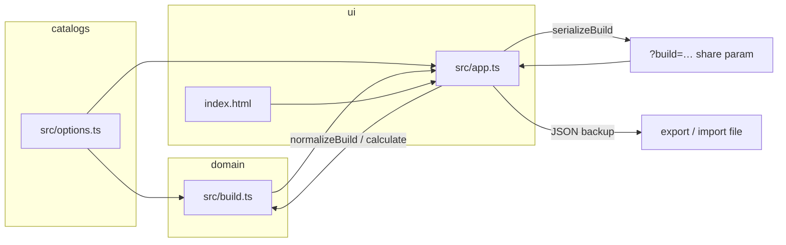

# Architecture

Static Vite + TypeScript single-page calculator. No server runtime beyond the Vite dev server or a static host (e.g. Vercel serving `dist/`).

## Major components

| Path | Role |
| --- | --- |
| `index.html` | Page shell and DOM structure the UI binds to |
| `src/app.ts` | UI wiring: selects, choice buttons, ledger render, share/export/import/print/undo |
| `src/build.ts` | Domain model: `Build`, normalize, calculate modifiers, serialize/parse share + backup |
| `src/options.ts` | Catalogs: attributes, ancestries, backgrounds, classes, milestones |
| `src/feat-data.ts` | Starting feat catalog and background grants from the Player Core books |
| `src/feats.ts` | Available starting feat slots and selection validation |
| `src/feat-picker.ts` | Search dialog and starting feat summary |
| `src/styles.css` | Presentation, including print-oriented styles |
| `test/build.test.ts` | Node test runner coverage for boost rules and build link/backup round-trips |
| `public/icon.svg` | Site icon |
| `public/og-image.jpg` | Open Graph / Twitter share image |
| `public/robots.txt` | Crawler policy + sitemap pointer |
| `public/sitemap.xml` | Single canonical URL for the calculator |

## Data and control flow

1. On load, `app.ts` reads optional `?build=` from the query string and `parseBuild`s it; otherwise it starts from `normalizeBuild()`.
2. User edits update an in-memory `Build`. `normalizeBuild` clamps invalid choices (wrong attributes, duplicates, unknown presets).
3. `calculate(build)` produces per-attribute rows (ancestry / background / class / free / advancement / total / partial) plus remaining boosts.
4. The ledger and step counts re-render from that result. The starting feat picker uses the selected ancestry, background, and class to offer slots and display grants.
5. Share links and backups use `serializeBuild` and `parseBuild` with `version: 1`. Backups also require `format: "pf2e-point-buy-calc"`. The optional `feats` record stores only chosen feats, so earlier links and backups open with empty feat choices.

## How a change typically lands

1. **Rules or catalogs** — edit `src/options.ts` and/or `src/build.ts`; extend `test/build.test.ts` for boost math, normalization, or serialization.
2. **UI / sharing UX** — edit `src/app.ts` and `index.html` / `src/styles.css`; keep share and backup formats backward-compatible unless you intentionally bump `version`.
3. **Verify** — `npm test`, `npm run typecheck` (also part of `npm run build`).

See [development.md](development.md) for commands and [decisions.md](decisions.md) for format and stack choices.
